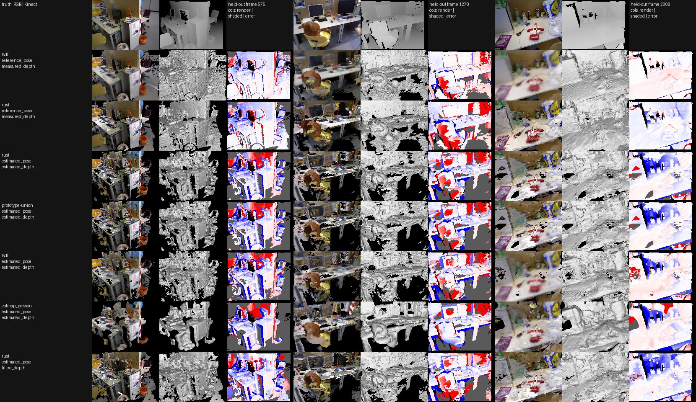
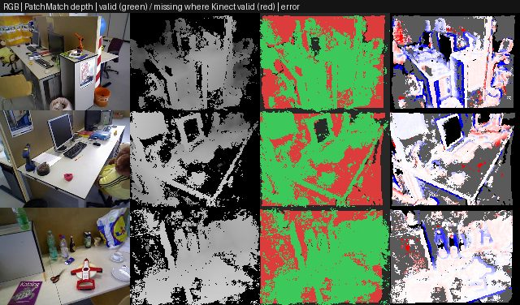

# Why the observed surface is still fragmented (TUM, 2026-11-21)

This is a diagnostic, not a geometry change. Exported meshes are byte-identical to the previous run (same SHA-256 for the TUM and H1 GLBs). The only change to production output is the new diagnostic fields in the `colmap-surface` report.

Harness and reproduction: [`tools/geometry-diagnostics`](../tools/geometry-diagnostics/README.md). Pinned source: TUM RGB-D `freiburg3_long_office_household`, 108-keyframe production capture, accepted local COLMAP registration, and 32-view geometric PatchMatch at 360 px (the run behind the 70.44% hit rate in `tools/colmap-dense/README.md`). TUM motion capture and Kinect depth are used only as evaluation oracles.

## Answer

1. **Fragmentation comes from surface assembly, not from depth or cameras.** The Rust `colmap-surface` stage gives the same shattered topology for every input combination, including motion-capture poses with Kinect depth:
   - 4,600–5,700 edge-connected components.
   - Largest component only 3.1–3.9% of triangles.
   - 3,000–5,000 vertex islands.

   TSDF fusion of the *identical* depth samples gives 63–73% in the largest component. Two mechanisms are visible in the code and confirmed by measurement:
   - **Per-source vertex duplication.** A reference grid sample has the same 3D position whichever source camera verified it. Each source's cells are meshed with their own vertex copies, so one reference view splits into source-wise islands. Meshing the verified union once per reference (prototype, not merged) cuts vertex islands 3,586 → 466 and edge components 4,833 → 2,223. Accuracy is unchanged.
   - **No cross-view fusion.** The 32 reference views are meshed independently and stacked. The production surface covers 72.9 m² for 54.4% correct coverage; TSDF fusion of the same samples covers 23.7 m² for 57.9%. That is about 3× overlapping layers that never connect.
2. **The largest loss of correct geometry happens earlier, at depth estimation.** Against the oracle ceiling (84.0% of held-out valid rays within 10 cm):
   - **Estimated cameras:** cost 0.2 pp. COLMAP centres are within 1.2 cm RMSE after one global similarity.
   - **PatchMatch depth:** costs 25.9 pp. After its geometric-consistency filter it has no value at 42% of reference pixels where Kinect is valid: the floor, desk tops and partition walls. The same stage drops 73% of samples on H1 and 99.7% on H3 (see the funnel below).
   - **Surface assembly:** costs another 3.5 pp.

   On the reference planes, production covers the floor at 1.2% (oracle 55.6%) and the vertical partition at 29.4% (oracle 87.1%). Where it does cover them, the error is 1.5–2.1 cm median, so those planes are **missing**, not misplaced.
3. **False positives are a minor and separate effect.** 9.0% of held-out rays hit geometry in front of the Kinect surface, mostly at depth edges. Only 0.5% of the surface area violates free space seen by Kinect. 82% of sampled surface lies within 5 cm of the Kinect reference.
4. **The renderer is not the cause.** Every visual below is a renderer-independent ray cast. The GLB declares `doubleSided: true`, so the three.js viewer draws back faces. A viewer that ignored that flag would hide 2.3 pp of correct coverage (54.4% → 52.1%).

**Earliest failing stage:** depth estimation. It is the first stage with a material loss and the largest loss of correct geometry. **Fragmentation itself** is created afterwards by surface assembly, independently of input quality.

## Controlled ablation (80 held-out views, 318,647 valid Kinect rays)

Held-out views lie midway between evaluation samples and are excluded from all keyframe selections. Rays are evaluated on an 8 px grid at motion-capture poses with native TUM intrinsics.

| Surface | Poses | Depth | ≤10 cm | ≤5 cm | False positive in front | Behind truth (hole) | Missing | Median cm | P90 cm |
| --- | --- | --- | ---: | ---: | ---: | ---: | ---: | ---: | ---: |
| TSDF reference | reference | Kinect | 84.0% | 78.1% | 3.0% | 5.6% | 7.5% | 1.6 | 8.8 |
| TSDF reference | estimated | Kinect | 83.8% | 77.8% | 4.1% | 4.9% | 7.2% | 1.6 | 9.5 |
| Rust stage | reference | Kinect | 74.1% | 65.2% | 5.6% | 6.3% | 13.9% | 1.9 | 17.2 |
| Rust stage | estimated | Kinect | 74.6% | 65.4% | 6.6% | 5.8% | 13.1% | 2.0 | 17.8 |
| TSDF reference | reference | PatchMatch | 58.4% | 49.6% | 7.2% | 8.2% | 26.2% | 2.7 | 30.8 |
| TSDF reference | estimated | PatchMatch | 57.9% | 49.4% | 8.0% | 8.2% | 26.0% | 2.6 | 33.7 |
| Rust stage | reference | PatchMatch | 53.6% | 45.3% | 8.1% | 7.5% | 30.9% | 2.6 | 31.5 |
| **Rust stage (production)** | estimated | PatchMatch | **54.4%** | 45.8% | 9.0% | 7.3% | 29.2% | 2.7 | 33.2 |
| Rust, union per reference (prototype) | estimated | PatchMatch | 55.3% | 46.4% | 9.6% | 7.1% | 28.0% | 2.8 | 32.7 |
| COLMAP fusion + Poisson (depth 9, trim 7) | estimated | PatchMatch | 52.5% | 46.3% | 7.5% | 5.3% | 34.7% | 2.2 | 31.7 |
| Rust stage | estimated | PatchMatch + MapAnything only where empty | 61.5% | 48.6% | 14.1% | 12.1% | 12.3% | 3.9 | 41.4 |
| Rust stage | estimated | MapAnything only | 39.8% | 24.0% | 27.7% | 20.8% | 11.7% | 11.7 | 69.3 |

On the 85 shared evaluation views, the production row matches `score_surface.py` exactly: 70.44% hit rate and 54.25% within 10 cm.

### Surface shape and precision

| Surface (estimated poses) | Triangles | Area m² | Components | Largest | Triangles in <32-triangle pieces | Boundary loops | Precision ≤5 cm | Free-space violation |
| --- | ---: | ---: | ---: | ---: | ---: | ---: | ---: | ---: |
| Rust stage, Kinect | 165,121 | 120.3 | 4,654 | 3.6% | 7.6% | 1,709 | 78.0% | 2.0% |
| TSDF reference, Kinect | 486,101 | 64.8 | 3,378 | 72.7% | 4.1% | 4,329 | 59.9% | 2.3% |
| **Rust stage, PatchMatch (production)** | 108,445 | 72.9 | 4,833 | 3.7% | 12.3% | 1,278 | 82.0% | 0.5% |
| Rust, union per reference (prototype) | 115,647 | 75.8 | 2,223 | 3.9% | 6.0% | 952 | 81.5% | 0.6% |
| TSDF reference, PatchMatch | 180,309 | 23.7 | 2,775 | 67.3% | 6.6% | 3,218 | 69.5% | 0.8% |
| COLMAP Poisson, PatchMatch | 131,149 | 10.5 | 35 | 99.2% | 0.1% | 10 | 92.7% | 1.0% |
| Rust stage, PatchMatch + MapAnything fill | 159,779 | 165.4 | 7,505 | 3.2% | 13.0% | 2,197 | 45.7% | 0.9% |

Components are edge-connected after merging coincident vertices, so separate texture pages do not split them. TSDF precision is lower mainly because its surface extends beyond the 4 m Kinect reference range: 20–33% of its area is unverifiable rather than contradicted.

### Per-view depth before fusion (32 reference views)

| Depth | ≤10 cm | In front | Behind | Missing | Median cm | P90 cm |
| --- | ---: | ---: | ---: | ---: | ---: | ---: |
| PatchMatch (production) | 47.8% | 6.3% | 3.6% | **42.3%** | 2.3 | 18.9 |
| MapAnything, one global scale | 43.4% | 13.3% | 36.6% | 6.7% | 11.3 | 47.1 |
| PatchMatch + MapAnything only where empty | 63.8% | 11.0% | 23.2% | 2.0% | 5.3 | 45.4 |

### Representative planes (reference surface from the full Kinect clip)

| Surface | Floor covered | Desk top (0.68 m) covered | Vertical partition covered | Median off-plane where covered |
| --- | ---: | ---: | ---: | ---: |
| TSDF reference, reference poses, Kinect | 55.6% | 74.9% | 87.1% | 1.3–2.1 cm |
| Rust stage, reference poses, Kinect | 30.5% | 77.5% | 68.5% | 1.3–1.8 cm |
| **Rust stage, production** | **1.2%** | 62.9% | **29.4%** | 1.5–2.1 cm |
| TSDF reference, PatchMatch | 2.0% | 63.8% | 43.3% | 2.0–2.4 cm |
| COLMAP Poisson | 0.2% | 49.4% | 24.1% | 1.2–2.5 cm |

"Covered" means a reference plane point has reconstructed geometry within 3 cm. Off-plane error is measured on samples within 5 cm of the plane's footprint.

## Stage funnel on the three gate videos

`colmap-surface` now reports where samples are lost: depth that is missing or rejected by each cross-view check, duplicate cells, islands and boundary edges. The local studio adds a one-line summary to the dense-surface status. TUM and H1 counts come from exports that are otherwise byte-identical to the previous ones. H3 counts come from a fresh PatchMatch run: the earlier gate run kept 4 triangles from 2 views, and this one produced no fused points at all.

| Video | Reference samples without PatchMatch depth | Accepted / attempted (per source) | Islands | Largest island | Dominant rejection |
| --- | ---: | ---: | ---: | ---: | --- |
| TUM (108 keyframes, 32 stereo views) | 47% | 195,320 / 590,400 | 3,586 | 3.8% | missing reference depth |
| H1 hotel room (19 stereo views) | 73% | 47,200 / 355,200 | 780 | 11.1% | missing reference depth |
| H3 airport (32 stereo views) | 99.7% | export refused: no verified triangles | – | – | (no surface) |

"Without PatchMatch depth" means PatchMatch's *geometric-consistency* output is empty. Its photometric depth is almost dense: 99.4% valid on TUM and 97.9% on H3.

On TUM the motion-capture poses are good, so the rejected areas are the ambiguous low-texture surfaces.

On H3, each view's photometric depth agrees with COLMAP's own sparse landmarks (median 1.9% relative error, 80% within 5%; TUM 0.6% and 94%). Even so, only 35 of 15,913 landmark pixels survive geometric consistency (TUM: 15,390 of 17,476). Two causes are therefore ruled out for H3: raw per-view depth and sparse pose triangulation. The first failing stage is PatchMatch's cross-view consistency filtering, or the source views it is given. Moving people in the waiting hall may contribute. There is no H3 oracle, so this stays a measured lead for follow-up 3, not a conclusion.

## Learned depth (MapAnything), bounded run

The test was warranted because depth is the largest loss. Run details:

- Model: `facebook/map-anything-apache` @ `00f9c245`, fp32 weights, bf16 autocast, memory-efficient inference with minibatch 1, and the estimated COLMAP calibration as intrinsics.
- Input: 504×378, four groups of 8 reference views.
- Hardware: RTX 3060 Ti 8 GB, with the process capped at 7.5 GiB. Peak was 6.00 GB allocated and 6.23 GB reserved; each group took about 2.8 s.

Findings:

- **Scale:** one global scale from 15,094 COLMAP landmark observations, no oracle. Per-group scale drifted from −16% to +7%.
- **Learned depth alone** is worse than PatchMatch: 43% correct with a median error of 11 cm.
- **Filling only PatchMatch holes** raises correct coverage by 7 pp (54.4% → 61.5%). It also adds 5 pp of false positives in front and 5 pp of rays behind the truth, and drops precision ≤5 cm from 82% to 46%.
- **Rust verification doesn't catch it**, because learned maps agree with each other across views. That agreement is not independent geometric evidence.

Learned depth is therefore **not** ready to fill unsupported areas. Under Atlas 2.3 and 2.8 it may only enter after a validation that is independent of the model, with learned provenance kept.

## Visual comparison (three held-out views)

Top row: real RGB and Kinect depth. Each method row has three columns:

- Ray-cast textured or vertex-coloured render.
- Untextured shaded mesh.
- Signed depth error: blue means in front of the truth, red means behind it, grey means missing, black means no Kinect value.

Rows, top to bottom:

1. TSDF, oracle poses and depth.
2. Rust stage, oracle poses and depth.
3. Rust production.
4. Union prototype.
5. TSDF on production depth.
6. COLMAP Poisson.
7. Rust with MapAnything fill.

The shaded column shows the production surface as overlapping shards even where its depth is correct.

Production PatchMatch depth at three reference views. Columns: RGB, estimated depth, validity, error. In the validity column, green has depth and red marks pixels where Kinect is valid but stereo has none. The red areas are the textureless floor, desk and partition surfaces.

## Follow-up 1 result: verified samples meshed once per reference view

The change is implemented in `colmap_surface.rs` as `verified_union`. Each region now lists exactly the source cameras that verified its retained vertices. The PatchMatch input, verification rules and mesh rules are the same as before.

| Measure | Before | After |
| --- | ---: | ---: |
| TUM vertex islands (Rust report) | 3,586 | 466 |
| TUM islands under 32 triangles | 3,436 | 358 |
| TUM edge components / triangles in pieces under 32 triangles | 4,833 / 12.3% | 2,223 / 6.0% |
| TUM boundary loops | 1,278 | 952 |
| TUM held-out ≤10 cm / false positive in front / missing | 54.4% / 9.0% / 29.2% | 55.3% / 9.6% / 28.0% |
| TUM held-out median / P90 depth error | 2.7 / 33.2 cm | 2.8 / 32.7 cm |
| TUM precision ≤5 cm / free-space violation | 82.0% / 0.5% | 81.5% / 0.6% |
| TUM 85 shared evaluation views: hit rate / ≤10 cm | 70.44% / 54.25% | 71.71% / 55.14% |
| TUM triangles | 108,445 | 115,647 |
| Yellow die: triangles, IoU in frames 6 / 101, median depth error | 897, 0.894 / 0.716, 1.47 / 1.30 cm | 930, 0.894 / 0.717, 1.47 / 1.30 cm |
| Yellow die: headless Blender independent move and vertex edit, other meshes preserved | pass | pass |
| H1 islands / small islands / boundary edges / triangles | 780 / 740 / 10,091 / 25,777 | 153 / 127 / 6,937 / 27,266 |
| H3 | no verified surface | no verified surface (PatchMatch consistency, follow-up 3) |

Fragmentation *within* a reference view is fixed. The largest island is still about 4% of the surface, because the 32 reference views remain separate stacked meshes; that is follow-up 2. No authored Blender scene expectation exists for H1's observed surface, so the die check is the Blender gate this stage has.

## Follow-up 3, first result: PatchMatch sources need parallax

`tools/colmap-dense/reconstruct.py` ranked PatchMatch sources by shared sparse points only. On a handheld walk those are the adjacent frames. PatchMatch keeps a pixel only when two sources each see it at 3° or more, but H3's chosen pairs had a median of **1.24°**: only 5% reached 3°, and 1 of 32 reference views had two usable sources. TUM's pairs had a median of 8.6°, and all 32 views had two usable sources.

The selection keeps the covisibility ranking for clusters and sources. Only where fewer than two of the chosen views reach 3° do the least covisible picks without parallax give way to the most covisible views with it. A first version ranked *only* among views at 3° or more. It changed TUM's reference views too, and the yellow die then localized inconsistently and lost its object surface, so it was replaced. With the current rule, TUM's PatchMatch configuration is identical to before (checked offline), and so are its surface and die.

| Video | Geometric depth valid | Fused points | Rust triangles | Missing reference samples | Islands |
| --- | ---: | ---: | ---: | ---: | ---: |
| H3 before → after | 0.3% → 3.4% | 0 → 60 | refused → 713 (5 views) | – → 96.5% | – → 23 |
| H1 before → after | – | 6,258 → 6,418 | 27,266 → 27,463 | 73.4% → 73.3% | 153 → 152 |
| TUM | unchanged (identical configuration) | | | | |

H3 now produces a verified surface, but it is very small. Restoring H3's depth needs more than source choice (follow-up 3 continues). H3 has no depth oracle, so its accuracy is not measured.

## Follow-up 2, first result: cross-view fusion (draft)

`colmap_surface` now passes the independently meshed reference views through the classic pipeline's existing cross-reference fusion and ownership merge (`surface_fusion.rs`, `surface_merge.rs`). Mutually nearest, normal-aligned seam vertices become shared. A view linked by such seams that already meshes a surface owns it, and the duplicated copy is removed. Partially owned triangles are clipped with lineage-carrying derived vertices.

Two changes were needed in shared code:
- **Unconformable clips.** A single clip that cannot be split without a T-junction used to reject the whole merge. This provider instead drops only that triangle and counts it: 1–3 per TUM export. The classic browser path is unchanged.
- **Object labels on clip pieces.** The object partition now labels triangles whose corners have observed *provenance* (`provenance_point`), so clip pieces can carry an object label. Object localization still uses observed points only.

Measured on the same TUM PatchMatch grids (80 held-out views, with the die inventory):

| Measure | Union per view (#261) | + fusion |
| --- | ---: | ---: |
| Held-out ≤10 cm / false positive in front / behind / missing | 55.3% / 9.6% / 7.1% / 28.0% | 54.7% / 8.8% / 7.6% / 28.9% |
| Median / P90 depth error | 2.8 / 32.7 cm | 2.8 / 33.0 cm |
| Triangles / area | 115,647 / 75.8 m² | 78,389 / 26.2 m² (TSDF reference: 23.7 m²) |
| Largest edge-connected component | 3.9% | **76.8%** |
| Largest vertex-connected island (Rust report) | 4.1% | 94% |
| Triangles in pieces under 32 triangles / boundary loops | 6.0% / 952 | 13.2% / 3,916 |
| Precision ≤5 cm / median distance to Kinect / free-space violation | 81.7% / 1.4 cm / 0.5% | 75.7% / 1.9 cm / 0.9% |
| Desk / partition / floor covered | 63.9% / 31.3% / 1.2% | 63.4% / 32.7% / 1.3% |
| Untextured surface area | 0% | **7.2%** |
| Yellow die: triangles, IoU 6 / 101, median depth error | 930, 0.894 / 0.717, 1.47 / 1.30 cm | 389, 0.877 / 0.695, 1.65 / 1.42 cm |
| Yellow die: headless Blender independent edit | pass | pass |
| Export time / peak RSS | 4.4 s / 221 MB | 55 s / 285 MB |

On H1, the largest island grows from 11.7% to 64.7% of triangles (27,463 → 18,880 triangles), and 5.5% of the area is untextured. H3's surface is too small to change.

The stacked duplicates are gone, and most of the scene is one connected surface, at unchanged coverage. Three costs remain before this can merge:
- **Untextured seams.** All untextured triangles are seam triangles spanning two views. The single-camera seam rule rejects them mostly as grazing views (1,424 on H1) or ambiguous (383).
- **Precision.** Precision drops 6 pp. In absolute terms, area off the Kinect surface falls from about 13.9 to 6.4 m², but the steep seam triangles suggest some stitches bridge depth steps.
- **Slivers.** The share of triangles in tiny pieces rises from 6% to 13%.

The export now reports the fusion funnel and the untextured reasons.

## Prioritised follow-up

1. **Done (see above).** **Mesh the verified union once per reference view** (smallest fix, `colmap_surface.rs`, about 15 lines).
   - What: build one grid from all verified samples of a reference view (positions come from the reference depth, so they are identical across sources). Mesh it once, with one `GeometricMultiView` region listing every supporting source.
   - Measured on TUM: vertex islands 3,586 → 466, edge components −54%, triangles in <32-triangle pieces 12.3% → 6.0%, boundary loops 1,278 → 952. Correct ≤10 cm 54.4% → 55.3%, false positives in front 9.0% → 9.6%, precision unchanged.
   - Gate: H1, H3 and the Blender acceptance must be rerun before merging, because exported topology changes.
2. **Fuse verified samples across reference views in Rust** instead of stacking per-view 2.5D meshes.
   - What: for example a truncated signed-distance or visibility-consistent fusion over verified `GeometricMultiView` samples only, inside `video-to-3d-core` behind `ReconstructionEvidenceView`. No new geometry authority, and empty space stays empty.
   - Upper bound measured with TSDF on identical samples: largest component 3.7% → 67%, area 72.9 → 23.7 m², correct +3.5 pp. Integrate only verified samples within the measured depth range, so the extra unverifiable area seen with raw TSDF does not appear.
3. **Recover consistent stereo depth** (largest coverage loss: 26 pp on TUM; 73% of samples missing on H1; 99.7% on H3).
   - The loss happens where PatchMatch's geometric-consistency filter rejects photometric depth that exists.
   - PatchMatch currently runs at 360 px, with 4 sources and 32 views.
   - Start with H3, where per-view depth already agrees with sparse landmarks: inspect source selection in `reconstruct.py` and the geometric-consistency and filtering options.
   - Then, on TUM, measure with this harness how a larger `max_image_size` and more sources change missing depth on the floor, partition and desk planes. Do this before touching fusion thresholds.
4. **Learned depth only behind independent validation.** MapAnything fill gains coverage but brings model-consistent false positives and scale drift. Keep it diagnostic until a model-independent check exists, such as agreement with geometric PatchMatch or sparse tracks per region and photometric reprojection, with learned provenance preserved.
5. **Verification tolerance (low priority).** With oracle depth the Rust stage keeps 74% versus TSDF's 84%. The dominant oracle rejection is 2% relative depth disagreement against the nearest grid sample. Consider footprint-aware tolerance only after items 1 and 2.

## Limitations

- One pinned clip and one PatchMatch run. GPU PatchMatch is not bit-reproducible: the H3 reruns produced 4 triangles and then none.
- The oracle reference-pose runs re-render frames into an ideal centred camera, and their sparse tracks are synthetic, so the unchanged Rust checks accept motion-capture cameras.
- TSDF uses 2 cm voxels and the same 32 views and grid samples as the Rust stage. It is a fusion reference, not a production proposal.
- COLMAP Poisson needed non-default settings (octree depth 9, trim 7). Defaults returned an empty mesh for about 33k fused points.
- Plane statistics depend on RANSAC segmentation of the Kinect reference. Planes the reference views never saw are omitted.
